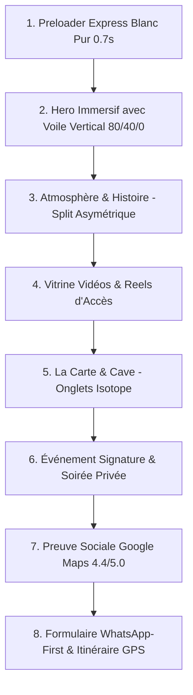

# 🏛️ SKILL : DIRECTION ARTISTIQUE (DA) & DESIGN SYSTEM RESTAURATION HAUT DE GAMME

Ce skill codifie la Direction Artistique et les règles d'ingénierie visuelle pour concevoir des sites vitrines de restaurants gastronomiques, bars à vins, lounges et hôtels d'exception, avec une valeur perçue immédiate de **15 000 $ à 20 000 $** (zéro effet « bouillie IA » / *AI Slop*).

---

## 🚫 1. LES INTERDICTIONS FORMELLES (ANTI-AI SLOP)

1. **Aucun dégradé kitsch ni lueur violette/cyan :**
   - ❌ Interdiction des gradients multicolores (`linear-gradient(135deg, #667eea, #764ba2)`) et des lueurs floues d'arrière-plan (`blur-3xl`, `bg-purple-500/10`).
   - ✅ Fonds **100% unis et mats** (Noir caviar profond `#040D10`).
2. **Aucun conteneur à bords arrondis criards avec effet « vitre sale » (Glassmorphism excessif) :**
   - ❌ Pas de conteneur rouge vin ou bordeaux avec de faux reflets lumineux.
   - ✅ Conteneurs épurés, transparents ou mats avec bordures ultrafines (1px `#FFD28D` ou `#252525`).
3. **Aucun emoji dans les boutons ni badges :**
   - ❌ Bannir les emojis (🍷, 🍽️, 📍, ⭐).
   - ✅ Utiliser uniquement des icônes vectorielles SVG fines (1.25px - 1.5px stroke).
4. **Pas de centrage monotone systématique :**
   - ❌ Empilement statique de boîtes centrées au milieu.
   - ✅ Compositions asymétriques (splits 60/40, disposition décalée texte/image).

---

## 🎨 2. LA PALETTE CHROMATIQUE STRICTE (MAT & SOMBRE)

| Rôle | Teinte | Code HEX | Usage obligatoire |
| :--- | :--- | :--- | :--- |
| **Fond Primaire** | Noir Caviar / Ardoise | `#040D10` | 100% mat, immersif. Sublime la verrerie et les photos de nuit. |
| **Accent Doré** | Champagne Doré | `#FFD28D` | Bordures 1px, sous-titres, badges discrets, puces de listes. |
| **Texte Principal** | Blanc Pur | `#FFFFFF` | Titres majeurs et informations capitales. |
| **Texte Secondaire**| Gris Cendre | `#C8C8C8` | Paragraphes de réassurance, adresses, descriptions de plats. |
| **Surfaces d'Input**| Blanc Céramique | `#FFFFFF` | Zones de formulaire (`color: #111111`) pour lisibilité instantanée. |
| **Bouton WhatsApp** | Vert Officiel | `#25D366` | Conversion directe avec texte et icône vectorielle en blanc `#FFFFFF`. |

---

## 🔤 3. LE DUO TYPOGRAPHIQUE DE CARACTÈRE

* **Titres & Display (Noble & Éditorial) :**
  - **Police prioritaire :** `Baskervville` (Google Fonts) avec rendu italique soigné pour les mots d'accroche.
  - **Alternatives autorisées :** `Cinzel`, `Playfair Display`, `Cormorant Garamond`.
  - *Interdiction formelle d'utiliser Inter, Roboto ou Arial pour les titres.*
* **Corps, Boutons & Formulaires (Ultra-lisible & Contemporain) :**
  - **Police prioritaire :** `Prompt` ou `Plus Jakarta Sans`.
  - Poids : `400` pour le corps, `500`/`600` pour les boutons en majuscules avec espacement de lettres (`letter-spacing: 1px à 2px`).

```html
<!-- Importation Google Fonts recommandée -->
<link rel="preconnect" href="https://fonts.googleapis.com">
<link href="https://fonts.googleapis.com/css2?family=Baskervville:ital@0;1&family=Prompt:ital,wght@0,300;0,400;0,500;0,600;0,700;1,400&display=swap" rel="stylesheet">
```

---

## 🏗️ 4. ARCHITECTURE & COMPOSITION DES 8 BLOCS MAJEURS



### 1. Preloader Express (0.7s)
* Cercle rotatif blanc `#FFFFFF` + logo circulaire blanc au centre.
* Disparition en 700ms max avec fondu `opacity: 0` pour préserver le SEO et l'attention.

### 2. Hero Immersif avec Voile Sombre Vertical
Pour garantir un contraste 10/10 sur la photo de fond sans noyer l'image :
```css
.hero-overlay {
  position: absolute;
  inset: 0;
  background: linear-gradient(180deg, rgba(0,0,0,0.80) 0%, rgba(0,0,0,0.40) 50%, rgba(0,0,0,0.00) 100%);
  pointer-events: none;
}
```

### 3. Présentation Asymétrique (L'Atmosphère)
* 60% de la largeur pour un visuel immersif avec zoom parallaxe.
* 40% pour un texte court (3 phrases maximum) avec lettrine ou sous-titre doré.

### 4. Menu & Carte par Onglets Interactifs
* Onglets horizontaux fins (Entrées / Plats / Desserts / Cave & Crus).
* Ligne de séparation fine pointillée dorée avec prix nets alignés à droite.

---

## ⚡ 5. MOTEUR D'ANIMATION GSAP 3 & SCROLLSMOOTHER

### Initialisation ScrollSmoother Haute Performance
```javascript
gsap.registerPlugin(ScrollTrigger, ScrollSmoother, ScrollToPlugin);

const smoother = ScrollSmoother.create({
  content: "#scrollsmoother-container",
  smooth: 1.1,
  normalizeScroll: true,
  ignoreMobileResize: true,
  effects: window.innerWidth > 991 ? true : false,
  smoothTouch: true,
});
```

### Parallaxe Cinématique sur les Bannières
Appliquer l'attribut `data-speed="1.1"` sur les images de section pour un léger effet de profondeur au défilement.

### Navigation Universelle & Auto-Fermeture du Menu Plein Écran
```javascript
$(document).on('click', 'a[href^="#"]', function(e) {
  var href = $(this).attr('href');
  if (href && href.length > 1) {
    var target = $(href);
    if (target.length) {
      e.preventDefault();

      // Fermeture automatique du menu hamburger si ouvert
      var akMenuToggle = document.getElementById('akMenuToggle');
      var topMenuLi = document.querySelector('.top-main-menu-li');
      if (topMenuLi && window.getComputedStyle(topMenuLi).display !== 'none') {
        if (akMenuToggle) akMenuToggle.click();
      }

      // Scroll fluide GSAP ScrollSmoother
      setTimeout(function() {
        if (window.ScrollSmoother && typeof ScrollSmoother.get === 'function' && ScrollSmoother.get()) {
          try {
            ScrollSmoother.get().scrollTo(target[0], true, 'top top');
          } catch(err) {
            target[0].scrollIntoView({ behavior: 'smooth' });
          }
        } else {
          $('html, body').animate({ scrollTop: target.offset().top - 80 }, 600);
        }
      }, 120);
    }
  }
});
```

---

## 📲 6. COMPOSANT RÉSERVATION WHATSAPP-FIRST (SANS BASE DE DONNÉES)

### Règle d'Or de l'Interface de Réservation
* **Conteneur :** Fond transparent (`background: transparent !important`), zéro bordure lourde, zéro lueur.
* **Champs de saisie :** Fond blanc `#FFFFFF`, texte noir `#111111`, bordure fine `#D0D0D0`.
* **Sélecteurs rapides :** Boutons pilules pour les dates (`Aujourd'hui`, `Demain`, `Ce week-end`) et les créneaux (`Midi 12h30`, `Dîner 20h00`, `Soirée 21h30`).
* **Icônes natives :** `filter: none` sur les picto calendrier et horloge pour un rendu noir naturel net.

### Script de Génération du Message WhatsApp
```javascript
var bookingForm = document.getElementById('restaurant-booking-form');
if (bookingForm) {
  bookingForm.addEventListener('submit', function(e) {
    e.preventDefault();
    var name = (document.getElementById('cust-name').value.trim()) || 'Client';
    var guests = document.getElementById('cust-guests').value;
    var date = document.getElementById('cust-date').value;
    var time = document.getElementById('cust-time').value;

    var msg = "Bonjour " + restaurantName + ", je souhaite effectuer une réservation :\n\n" +
              "• Nom : " + name + "\n" +
              "• Date : " + date + "\n" +
              "• Heure : " + time + "\n" +
              "• Nombre de personnes : " + guests + "\n\n" +
              "Merci de me confirmer la disponibilité.";

    var waUrl = "https://wa.me/" + restaurantWhatsApp + "?text=" + encodeURIComponent(msg);
    window.open(waUrl, '_blank');
  });
}
```

---

## 📍 7. BOUTON D'ACCÈS GOOGLE MAPS EXTERNE (ZÉRO IFRAME LOURDE)

Supprimer impérativement les iframes Google Maps lentes et bloquantes. Utiliser un bouton CTA centré ouvrant l'application native :
```html
<a href="https://maps.google.com/?q=COORDONNÉES_GPS_OU_ADRESSE" target="_blank" rel="noopener noreferrer" class="ak-btn style-5" style="border-color: #FFD28D; display: inline-flex; align-items: center; justify-content: center; gap: 12px; padding: 15px 32px; text-decoration: none; border-radius: 8px;">
    <svg width="22" height="22" viewBox="0 0 24 24" fill="none" stroke="currentColor" stroke-width="2" stroke-linecap="round" stroke-linejoin="round">
        <path d="M21 10c0 7-9 13-9 13s-9-6-9-13a9 9 0 0 1 18 0z"></path>
        <circle cx="12" cy="10" r="3"></circle>
    </svg>
    <span style="letter-spacing: 1px; font-weight: 600; text-transform: uppercase; font-size: 14px;">Ouvrir l'Itinéraire dans Google Maps</span>
</a>
```
